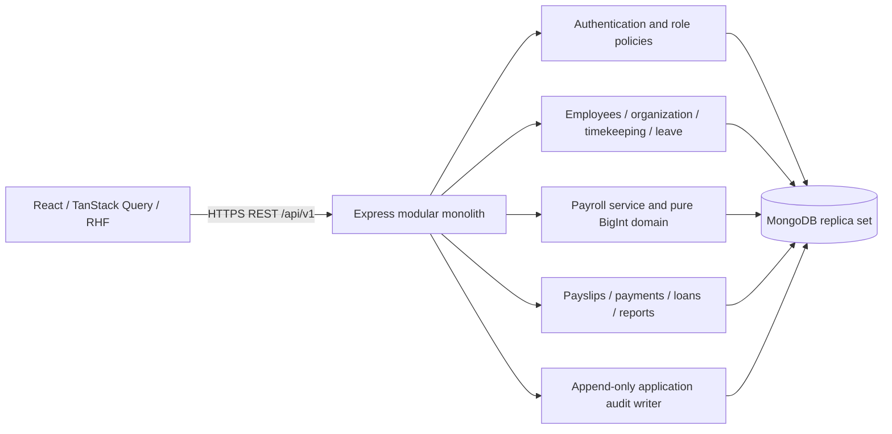

# GinhawaHR architecture

One repository, one Express application, one logical MongoDB database. React is compiled separately and served by Express in production. No microservices or service-to-service network calls.

Routes validate DTOs and dispatch services. Employee persistence and scope lookup use a repository; business workflows use services. The financial core is an independent deterministic function. Small reference-data resources share route registration; sensitive business flows have separate routes and services. Mongoose models are currently centralized under infrastructure to keep relationships explicit. Further module-local repository extraction is tracked in TODO.md; this is not yet full compliance with the requested per-module layering.

All business collections carry companyId. The current application is an internal single-company product, without billing or multi-tenant registration. Role permissions are loaded from MongoDB on each authenticated request; company and resource scopes are checked server-side. JWTs also require an active server session.

MongoDB transactions surround payroll calculation, payroll transitions, leave debits, attendance edits and payment reconciliation. Unique indexes protect cutoffs, idempotency keys, payroll employee items, payslips and payment batches. Run revisions protect concurrent changes. Finalized calculations cannot be recalculated via API.

Frontend authentication tokens exist only in Zustand memory. Refresh cookies authorize refresh/logout only; these actions require exact Origin and CSRF token validation. User-specific React Query data is cleared on logout, expiration and account replacement. Requests from a previous account generation are discarded before response delivery or retry. Rotation preserves the current account and does not clear its cache; these behaviors have dedicated tests.

Timekeeping and leave depend on an explicit PeriodLockPolicy interface. Its MongoDB implementation blocks edits/imports and late leave/overtime decisions for locked payroll periods. Further transaction conflict coverage between input writes and simultaneous finalization remains required.

Financial finalization is intentionally blocked by an engine validation exception. This is an implemented safety gate, not a complete Philippine statutory engine. There is no production compliance claim.
