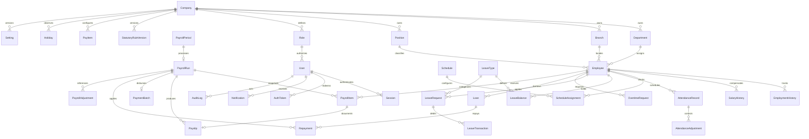

# Collections and relationships

Every business record has companyId. An employee belongs to a department and branch and may reference a position and reporting employee. A user references a role and optionally an employee. Session and single-use token records reference the user.

References are ObjectIds, not database foreign keys. Services check company ownership and resource scope before protected writes. Not all cross-reference constraints are yet covered (see TODO). Indexes are declared in `server/src/infrastructure/models.ts`. Transactions require a replica set. Session/token expiry indexes do not replace application expiry checks. Financial values are decimal strings representing integer centavos; salary and payroll snapshots retain inputs and policy versions.

Application routes provide no audit update/delete endpoint. This alone is not tamper-proof storage: production must use a narrowly scoped database identity and an independent backup/audit retention process. Archival uses the employee Archived state; full configurable retention/anonymization remains unimplemented. Never choose a statutory retention period without a reviewed company policy.
